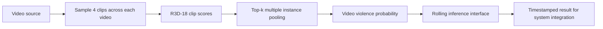

# Campus Threat Detection - P2

P2 is the temporal behavior recognition component of the campus threat detection project. It scores short video windows for violence related activity and exposes a rolling inference interface for recorded video or a live frame source.

This repository combines the supplied UCF-Crime R3D-18 notebook with the supplied video-classification project. The notebook remains a separate UCF-Crime experiment. The main training path is now configured for XD-Violence and its video-level weak labels. The two datasets are not mixed into one training split because their labels and evaluation protocols differ.

## What is included

- **UCF-Crime:** an original notebook and a portable project copy for the Fighting versus Normal experiment.
- **XD-Violence:** manifest preparation, a video-level multiple instance learning trainer, held-out video evaluation, temporal inference, and a real-time classifier interface.
- **Prototype support:** a synthetic video generator for exercising the data and inference pipeline when the licensed datasets are unavailable.
- **Documentation:** dataset mapping, model card, architecture, reproduction steps, current evidence, and known limitations.

Raw UCF-Crime and XD-Violence videos, generated media, and per-video evaluation logs are excluded from source control. The selected XD-Violence checkpoint is included in this handoff and configured for Git LFS because it is larger than GitHub's regular-file limit. See [experiment status](docs/experiment_status.md) for the exact data scope and results.

Before committing the checkpoint to GitHub, install Git LFS and run `git lfs install`; `.gitattributes` is already set up to track `checkpoints/best_model.pt` with LFS. The training data and generated manifests are not part of this archive and must remain outside the public repository.

## Pipeline



Training uses one weak label per video and pools several clip scores into a video score. This avoids treating every window in a violent video as a violent clip when only part of the video contains an event. The supplied notebook is a separate clip-classification experiment and does not share its trained weights with the XD-Violence pipeline.

## Folder layout

```text
campus-threat-detection-p2/
├── configs/                 # Model, dataset and training configuration
├── data/
│   ├── raw/                  # Local datasets; ignored by Git
│   ├── splits/               # Generated manifests; ignored by Git
│   ├── dataset.py            # Synthetic/clip-level prototype dataset
│   ├── video_bag_dataset.py  # XD weak-label video bags
│   └── xd_violence.py        # XD labels and annotation parsing
├── docs/                     # Scope, data protocol, model card, results status
├── interfaces/               # Frame source and alert event interfaces
├── models/                   # R3D-18 model and rolling classifier
├── notebooks/
│   ├── UCF_Crime_R3D18.original.ipynb
│   └── ucf_crime_r3d18.ipynb
├── scripts/                  # XD manifest preparation
├── tests/                    # Supplied unit tests
├── train.py                  # Train XD-Violence with video-level MIL
├── evaluate.py               # Fixed-threshold held-out video evaluation
└── realtime_demo.py          # Recorded video or synthetic stream demonstration
```

## Setup

Use Python 3.10 or newer. Install a PyTorch and torchvision build that matches the machine's CUDA runtime first, then install the remaining dependencies:

```powershell
python -m venv .venv
.venv\Scripts\Activate.ps1
python -m pip install --upgrade pip
python -m pip install torch torchvision
python -m pip install -r requirements.txt
```

The R3D-18 weights are downloaded by torchvision when `model.pretrained` is enabled. Keep the machine connected to the internet for the first model initialization, or set `pretrained: false` in the config to train from scratch.

## Prepare XD-Violence

Obtain the dataset through the [official XD-Violence project page](https://roc-ng.github.io/XD-Violence/), review its access terms, then place the local files in this layout:

```text
data/raw/XD-Violence/
├── Train/                     # Official training videos, including filename label tags
├── Test/                      # Official test videos
└── annotations.txt            # Official test interval annotations
```

If the downloaded folder names differ, pass their paths explicitly. Then create train, validation, and official test manifests:

```powershell
python -m scripts.prepare_xd_violence `
  --dataset-root data/raw/XD-Violence `
  --train-dir data/raw/XD-Violence/Train `
  --test-dir data/raw/XD-Violence/Test `
  --test-annotations data/raw/XD-Violence/annotations.txt `
  --training-source "1005-2004 archive; 996 available videos"
```

The script makes a stratified validation split from the training videos available locally and keeps the test videos untouched. It recognizes Fighting, Shooting, Riot, and Abuse as the human-violence target; Normal is the negative class. Videos labeled only as Car Accident or Explosion are excluded instead of being treated as normal. See [dataset protocol](docs/dataset_analysis_and_mapping.md) for details.

The run documented here used the `1005-2004` archive found in the workspace, not the `0001-1004` shard originally expected. Of the archive's 1,000 listed videos, 996 were available as readable local files; four were missing, including one archive member that failed its CRC check during extraction. This is a reduced training subset, not the full XD-Violence training split. The generated manifest summary records the actual source and counts, and the checkpoint and evaluation report carry that provenance forward. If you use a different shard, update `--training-source` to describe it accurately.

## Train and evaluate

Run from the repository root:

```powershell
python train.py --config configs/training_config.yaml --device cuda --epochs 8 --batch_size 2
python evaluate.py --config configs/training_config.yaml `
  --checkpoint checkpoints/best_model.pt `
  --manifest data/splits/xd_test_manifest.json
python error_analysis.py --report logs/xd_test_evaluation.json
```

The best checkpoint is selected using validation F1. Training also selects a validation threshold and stores it in the checkpoint. Evaluation uses that saved threshold unless `--threshold` is explicitly supplied. The test set is never used for threshold selection. The report is written to `logs/xd_test_evaluation.json` and reports one result per source video.

For a short pipeline demonstration, generate toy clips explicitly:

```powershell
python train.py --synthetic --arch custom_3d_cnn --device cpu --epochs 1 --batch_size 2
```

Synthetic scores are software diagnostics only. They are not XD-Violence results and must not be presented as model accuracy on real footage.

## Run temporal inference

Once a compatible trained checkpoint is available:

```powershell
python realtime_demo.py `
  --source path\to\video.mp4 `
  --checkpoint checkpoints/best_model.pt `
  --config configs/training_config.yaml `
  --save_output logs/annotated_video.mp4
```

The `BehaviorClassifier` accepts OpenCV frames and returns `timestamp`, `window_start`, `window_end`, `violence_probability`, `is_violence`, `model_status`, and inference timing. Results are model evidence for human review, not confirmation that a threat occurred.

## UCF-Crime notebook

Use `notebooks/ucf_crime_r3d18.ipynb` for the portable copy. To rerun it, place the UCF-Crime `Fighting/` and `Normal_Videos_for_Event_Recognition/` folders and the `metadata/split_manifest.csv` and `metadata/fighting_intervals.csv` files under `data/raw/UCF-Crime/`, or set `UCF_CRIME_ROOT` to that location before launching Jupyter. Those raw videos and metadata files are not included. The notebook uses a video-disjoint split and extracts Fighting/Normal clips; it does not represent all UCF-Crime anomaly classes.

`notebooks/UCF_Crime_R3D18.original.ipynb` preserves the supplied notebook unchanged for reference.

The original notebook's saved output reports 0.887 accuracy on 62 held-out clips and 0.913 accuracy after majority voting over 23 held-out source videos (confusion matrix `[[11, 1], [1, 10]]`). These scores are preserved notebook output, not reproduced in this handoff, and cover only the notebook's Fighting/Normal subset. See [experiment status](docs/experiment_status.md) for scope and caveats.

## Project status

The XD-Violence baseline was trained for six completed epochs on 720 training videos, selected at validation F1 0.8085, then evaluated once on 621 label-eligible videos from the official test split. At the saved validation threshold of 0.4901, test accuracy was 0.7729, F1 0.7374, AUROC 0.8900, and recall 0.6168. The held-out evaluation excluded 179 hazard-only videos from the binary human-violence task. These are subset-experiment results, not a full-training-set benchmark and not evidence of campus-scene performance. See [experiment status](docs/experiment_status.md) and [limitations](docs/model_card_and_limitations.md).

The PDF brief suggests RWF-2000 for Member 2. This version follows the direct project request and uses the supplied UCF-Crime notebook plus an XD-Violence workflow. It covers P2 behavior recognition only; it does not claim to deliver the other team members' detector, tracker, camera application, or dashboard.
