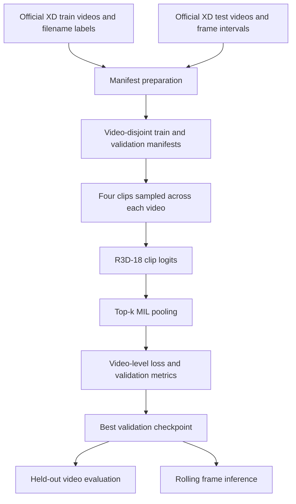

# P2 Architecture

## Responsibility

P2 is the temporal behavior recognition module. It receives video frames or a recorded video, forms temporal clips, scores possible violence-related activity, and returns a timestamped result. Object detection, tracking, camera capture, and the monitoring dashboard belong to the other project modules described in the assignment brief.

## XD-Violence training path



The official test set is not used during training or threshold selection. Validation videos are drawn only from the official training partition. Split manifests retain source video IDs so that clip-derived samples stay associated with their source.

## Inference contract

`models.behavior_classifier.BehaviorClassifier` accepts OpenCV frames in BGR order and optional timestamps. It buffers enough frames for one clip, applies the same resize and Kinetics normalization as training, and returns:

```json
{
  "timestamp": 12.4,
  "window_start": 9.4,
  "window_end": 12.4,
  "violence_probability": 0.78,
  "model_status": "valid",
  "is_violence": true,
  "inference_latency_ms": 24.1
}
```

The values above illustrate the schema; they are not measured results. A real checkpoint and a validation-selected threshold are required for meaningful predictions.

## Dataset tracks

- **XD-Violence:** main training path, weakly supervised at video level.
- **UCF-Crime:** separate Fighting versus Normal R3D-18 notebook experiment.

The tracks share the R3D-18 family and inference concept, but not datasets, labels, checkpoints, or benchmark claims.
