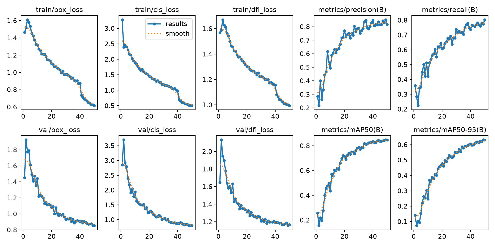

# Grouped-data detector evaluation

The selected YOLO11n checkpoint scores **85.79% mAP@50** and **65.89%
mAP@50-95** on the 700-image grouped test set. At the deployed confidence of
0.45, precision is 88.03% and recall is 77.94%. Knife recall is the weakest
class result at 68.24%.

This report assembles the saved experiment evidence already in this repository.
It does not claim a new training run or an independently collected campus test.
The [machine-readable test report](experiments/grouped_test.json) is the source
of the results below.

## Checkpoint and data

| Item | Value |
|---|---|
| Checkpoint | `models/dangerous_items_yolo11n.pt` |
| SHA-256 | `7097f954a4e7bb7ebf3bab163601c9b0329142226277f32db170a079cafadafc` |
| Architecture | Ultralytics YOLO11n |
| Training initialization | Original COCO-pretrained `yolo11n.pt` |
| Training | 50 epochs, 640 pixels, batch 16, AMP, seed 0 |
| Split | 3,267 train / 700 validation / 700 test images |
| Inference | 640 pixels, confidence 0.45, NMS IoU 0.7 |
| Fixed-threshold matching | IoU 0.5, class-aware, confidence-ordered, one-to-one |

The builder groups known augmentation filename families and byte-identical
images before splitting. It chooses one representative per group and excludes
86 groups with conflicting annotations. Online augmentation is confined to
training. See the [split summary](dataset/grouped_v1_summary.json),
[manifest](dataset/grouped_v1_manifest.csv), and
[data methodology](../docs/data_methodology.md).

This controls known image-family overlap. Different frames from an unidentified
source video may still be related. The earlier cleaned model's 88.2% mAP@50 came
from a different, contaminated split; it is not a fair baseline for a claimed
improvement or regression.

## Validation decisions

The [experiment plan](../configs/experiment_plan.yaml) defines the decision rule:
use 960 only if validation mAP@50-95 improves by at least 0.02 and warmed
model-stage p95 remains below 33.33 ms.

| Input size | Validation mAP@50 | Validation mAP@50-95 |
|---|---:|---:|
| 640 | 84.71% | 62.99% |
| 960 | 79.18% | 53.55% |

Sources: [640 run](experiments/validation_640.json),
[960 run](experiments/validation_960.json), and
[resolution decision](experiments/resolution_selection.json).
The larger size did not meet the quality condition, so 640 was retained.
This is an input-size comparison for one model, not a comparison of architectures.

Confidence candidates from 0.10 to 0.80 were scored on validation. The selected
0.45 threshold maximized macro F1; ties prefer macro recall, then lower confidence.
The [threshold record](experiments/validation_threshold.json) contains every
candidate and the model/dataset fingerprints. These settings were frozen for test.

## Frozen test results

| Class | TP | FP | FN | Precision | Recall | F1 |
|---|---:|---:|---:|---:|---:|---:|
| Machete | 106 | 19 | 39 | 84.80% | 73.10% | 78.52% |
| Knife | 101 | 22 | 47 | 82.11% | 68.24% | 74.54% |
| Baseball bat | 130 | 8 | 14 | 94.20% | 90.28% | 92.20% |
| Rifle | 110 | 13 | 30 | 89.43% | 78.57% | 83.65% |
| Gun | 97 | 12 | 24 | 88.99% | 80.17% | 84.35% |
| All objects (micro) | 544 | 74 | 154 | 88.03% | 77.94% | 82.67% |

These precision/recall values describe the deployed threshold, while mAP
summarizes a confidence sweep. They are not threat-recognition accuracy.
There were 70 images with false-positive boxes and 131 with missed objects.
None of 74 background images produced a retained box; this small image sample
does not establish a zero video false-alert rate.

The test JSON also contains a diagnostic confusion matrix. Its matching allows
cross-class geometric matches to expose label confusion; its diagonal should
not replace the class-aware TP counts above.

## Runtime and reproducibility

The saved GPU evaluation used an RTX 5060 Laptop GPU. Warmed model-stage time
averaged 11.82 ms with p95 15.74 ms, excluding image loading and output writing.
The [historical runtime record](experiments/runtime_verification.json) describes
the separate recorded-video runs. Neither is a complete camera-to-dashboard measurement.

For current hardware, run:

```powershell
python scripts/check_model_release.py
python scripts/benchmark_detector.py --image path/to/image.jpg --device cpu --runs 100 --warmup 10 --output outputs/benchmarks/cpu.json
python scripts/benchmark_detector.py --image path/to/image.jpg --device 0 --runs 100 --warmup 10 --output outputs/benchmarks/gpu.json
```

The benchmark records setup separately, all timed samples, and CUDA allocated
and reserved peaks when CUDA is available. It repeats one image and measures
runtime only. Use the README commands to reproduce dataset-wide accuracy.

The [17 November CPU run](experiments/cpu_benchmark_20261117.json) measured 40
predictions on one 994 x 600 image after warm-up: median 25.39 ms, p95 26.70 ms.
CUDA was unavailable during that initial check, so its GPU memory stays `null`.
This one-image CPU result is not directly comparable with the 700-image GPU
timing above.

After CUDA became available, the [fresh GPU run](experiments/gpu_benchmark_20261117.json)
repeated the same image 100 times on the RTX 5060 Laptop GPU, after ten blank-frame
warm-ups and one real-frame warm-up. Synchronized wrapper latency was **15.06 ms
median** and **16.53 ms p95**. Peak PyTorch allocated memory was **68.3 MiB** and
peak reserved memory was **86.0 MiB**, measured after warm-up. These figures
include model tensors but exclude CUDA driver/context memory and other processes.
They measure item-only inference, not total GPU usage or camera-to-display FPS.
The [hardware recheck](experiments/hardware_recheck_20261117.json) records the
successful CUDA environment check; the earlier failure is retained separately.

Training artifacts: [settings](experiments/training_args.yaml),
[epoch history](experiments/training_results.csv), and
[model card](../models/model_card.json).



## What remains uncertain

The [external pilot](person1_demo_and_external_pilot.md) matched only 1 of 12
provisional knife annotations. That is a substantial generalization concern,
even though the pilot is small and its labels need human review. Better
campus-like data and a fresh, independently reviewed holdout are needed before
making deployment claims. Changing the threshold after inspecting this pilot
would require new validation and evaluation evidence.

The separate pretrained person detector supplies boxes for the tracking module.
It has not been evaluated on a labeled campus-person dataset. Joint tracking,
live-camera reliability, and the final threat-assessment pipeline remain team
integration work.
