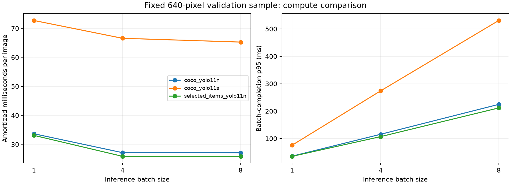

# Model size and inference batch comparison

On the available CPU, the general pretrained YOLO11s took **72.69 ms per image**
at batch 1, compared with **33.63 ms** for general pretrained YOLO11n. The larger
model was about **2.16 times slower** in this controlled compute experiment.
For the selected item detector, batching four images improved throughput, while
batching eight brought almost no further gain and roughly doubled batch latency.

These are executed measurements from 17 November 2026. The
[full result](experiments/model_batch_comparison_20261117.json) contains every
timed batch, the exact sample manifest, checkpoint hashes, configuration, and
software versions. This is an inference-cost comparison; the general checkpoints
were not evaluated as five-class weapon models.

## Method

The [fixed configuration](../configs/comparison.yaml) selects 64 images from the
grouped **validation** split using seed 42. All nine model/batch combinations
use those same images, repeated three times. Configuration order is shuffled
deterministically between repetitions to reduce order effects. There are 192
timed image presentations per combination, representing 64 unique images.

Each trial loads one model, runs two warm-up batches, and then measures completed
prediction calls. Images are decoded into memory before timing. Preprocessing,
inference and postprocessing are timed; file loading, initialization, warm-up,
plotting and report writing are excluded. `rect=False` forces the same square
640 x 640 network input for all batches. Eight CPU threads are used.

All configurations use confidence 0.25, NMS IoU 0.7 and at most 300 detections
for a common compute workload. The deployed item threshold remains **0.45**;
this experiment does not alter it. Consequently, these timings should not be
substituted for the deployed operating-point benchmark or live-camera timing.

| Checkpoint | Classes | Parameters | File size |
|---|---:|---:|---:|
| General pretrained YOLO11n | 80 COCO | 2,624,080 | 5.61 MB |
| General pretrained YOLO11s | 80 COCO | 9,458,752 | 19.31 MB |
| Selected item YOLO11n | 5 project classes | 2,605,855 | 5.49 MB |

Parameter counts are read from the loaded checkpoints before inference fusion;
file sizes use decimal MB. Class mappings and SHA-256 hashes are checked before
timing. The general checkpoints are identified by their official Ultralytics
release URLs in the configuration. See the
[YOLO11 documentation](https://docs.ultralytics.com/models/yolo11/) for the model
family and the [prediction documentation](https://docs.ultralytics.com/modes/predict/)
for batching and rectangular-input behavior.

## Results

| Model | Batch | Amortized ms/image | Images/second | Batch p95 (ms) |
|---|---:|---:|---:|---:|
| General YOLO11n | 1 | 33.63 | 29.73 | 35.72 |
| General YOLO11n | 4 | 27.12 | 36.87 | 115.53 |
| General YOLO11n | 8 | 27.08 | 36.93 | 224.56 |
| General YOLO11s | 1 | 72.69 | 13.76 | 75.71 |
| General YOLO11s | 4 | 66.56 | 15.03 | 273.97 |
| General YOLO11s | 8 | 65.26 | 15.32 | 530.58 |
| Selected item YOLO11n | 1 | 33.07 | 30.24 | 35.05 |
| Selected item YOLO11n | 4 | 25.86 | 38.67 | 107.00 |
| Selected item YOLO11n | 8 | 25.85 | 38.68 | 211.61 |

Amortized time is total measured milliseconds divided by processed images.
Batch p95 measures how long a complete batch takes; dividing it by batch size
would not give the time a live camera frame waits for a result. Queueing time
needed to accumulate a batch is outside this experiment.



## Interpretation for the project

The measurements support YOLO11n as the lower-cost choice for a CPU fallback.
They do not show that it is more accurate than YOLO11s. Both general models
share the COCO task, but only the selected item model has been fine-tuned for
the complete five-class project task. A controlled fine-tuned accuracy comparison
would require training both architectures under a separately declared plan.

Keep batch 1 for the current frame-by-frame API. Batch 4 is a useful option for
a future offline or queued multi-frame consumer: it reduced the selected model's
amortized cost by about 22% here. Batch 8 gave negligible additional throughput
on this CPU, with higher completion latency. The current public API and camera
demo continue to process individual frames.

The experiment compares **inference** batch sizes. It makes no claim about how
training batch size affects convergence. No test images, test metrics, external
pilot annotations, selected weights, or deployment settings were changed.

CUDA was unavailable when this CPU comparison ran, so its GPU allocator values
remain `null`. A later [hardware recheck](experiments/hardware_recheck_20261117.json)
passed, and a separate [item-only GPU benchmark](experiments/gpu_benchmark_20261117.json)
measured fresh CUDA latency and allocator memory. The table above still describes
CPU execution; the later benchmark does not rerun this model/batch comparison.

## Reproduce

From the repository root with the project environment activated:

```powershell
python -c "from ultralytics import YOLO; YOLO('yolo11n.pt'); YOLO('yolo11s.pt')"
python scripts/compare_detector_models.py --device cpu --output outputs/comparison/model_batches.json --plot outputs/comparison/model_batches.png
```

The script requires local checkpoints matching the recorded hashes. Existing
results are preserved unless `--overwrite` is supplied. For GPU measurements,
use a new output filename and `--device 0`. Compare runs only when their input
sample, model hashes, preprocessing, confidence, software and timing scope agree.

## Pretrained baseline on the two common classes

A separate executed comparison evaluates **knife and baseball bat only** on all
700 validation images. Those labels exist in both checkpoints; the general COCO
model has no matching machete, rifle or gun classes. The
[baseline result](experiments/common_class_baseline_20261117.json) records the
verified mapping, model/data hashes and fixed-threshold metrics. Per-image
predictions and ground truth are saved locally in
`outputs/baseline/common_class_predictions_20261117.json`, with its hash in the
compact report.

| Meaning | General COCO ID | Project ID |
|---|---:|---:|
| Knife | 43 | 1 |
| Baseball bat | 34 | 2 |

Both models use 640 x 640 square inputs, confidence **0.25**, NMS IoU **0.7**,
maximum 300 detections and inference batch 8. Evaluation uses the existing
class-aware, confidence-ordered one-to-one matching at IoU **0.5**. Predictions
are filtered to the two native classes, then mapped to the project IDs. The same
original labels are filtered to knife/baseball bat for both models.

All images remain in the evaluation. There are **292 target objects** and
**419 images with neither common class**; those images can still produce false
positives. Images containing only excluded classes count as negatives for this
restricted task, so this negative-image rate differs from the five-class report.

| Checkpoint | TP / FP / FN | Precision | Recall | F1 |
|---|---|---:|---:|---:|
| General pretrained YOLO11n | 98 / 102 / 194 | 49.00% | 33.56% | 39.84% |
| Selected fine-tuned YOLO11n | 236 / 67 / 56 | 77.89% | 80.82% | 79.33% |

| Checkpoint and class | Precision | Recall | F1 |
|---|---:|---:|---:|
| General pretrained: knife | 42.11% | 10.81% | 17.20% |
| Selected fine-tuned: knife | 75.52% | 72.97% | 74.23% |
| General pretrained: baseball bat | 50.62% | 56.94% | 53.59% |
| Selected fine-tuned: baseball bat | 80.00% | 88.89% | 84.21% |

The general model produced target-class false positives on **41/419** negative
images (9.79%); the selected model did so on **26/419** (6.21%). These are image
rates for the restricted task, not live-video false-alert rates.

The results describe how the selected fine-tune fits this dataset's two shared
labels. **This validation set was already used in model selection.** It is not
an untouched test or a causal estimate of the benefit of fine-tuning. COCO and
project annotation conventions may also differ. Confidence 0.25 was fixed for
the comparison; it was not tuned, and the deployed threshold remains 0.45.
No AP or five-class mAP is computed by this baseline.

Reproduce without changing the frozen five-class reports:

```powershell
python scripts/compare_pretrained_baseline.py --device cpu --batch 8 --output outputs/baseline/common_classes.json --predictions outputs/baseline/common_class_predictions.json
```

The comparison checks native class names before mapping and validates all source
labels before filtering. The validation content hash matches the original
validation-selection record. It does not use the test split or external pilot
to choose a model or a threshold.
